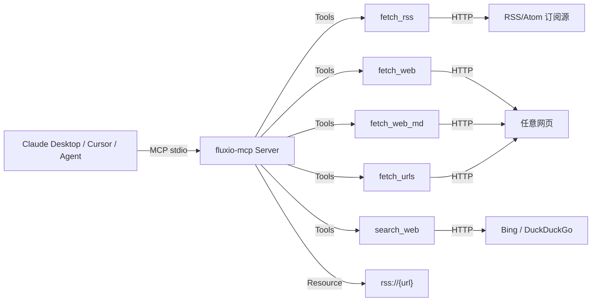

# Fluxio MCP

[](LICENSE)

[](https://github.com/IYABAO/fluxio-mcp/actions/workflows/ci.yml)

信息获取 MCP Server：解析 **RSS/Atom 订阅源**、抓取并提取**网页正文**，让 Claude / Cursor / 各类 Agent 直接读取任意信息源，无需自建爬虫。

> 基于 [FastMCP](https://github.com/jlowin/fastmcp) 实现，纯 Python、零后端依赖，即装即用。

## 架构



- `fetch_rss(url, limit)`：解析 RSS 2.0 / Atom，返回文章列表（标题/链接/时间/摘要）
- `fetch_web(url, max_chars)`：抓取网页并提取正文纯文本，自动去除导航/脚本/样式噪音
- `fetch_web_md(url, max_chars)`：抓取网页并**转换为 Markdown**（保留标题层级/列表/代码块/链接/图片/表格）
- `search_web(query, max_results)`：**网页搜索**（Bing 主端点国内可直连，DuckDuckGo 海外降级，免 API Key）
- `fetch_urls(urls, mode, max_chars)`：**批量抓取**（最多 5 个 URL，单点失败隔离，text/markdown 双模式）
- `rss://{url}`：订阅源资源，`rss://<地址>` 返回最近 15 篇

## 抓取健壮性（v0.2.0）

网络抓取的失败大多不是"源没了"，而是超时、限流、编码猜错。抓取层现在统一处理：

| 场景 | 行为 |
|---|---|
| 超时 | 连接 5s、读取 15s 分级超时，避免慢连接拖死整批 |
| 429 / 500 / 502 / 503 / 504、网络中断、读超时 | 自动重试 2 次，指数退避（0.4s、0.8s） |
| 403 / 404 等确定性错误 | 不重试，直接返回原因 |
| 超大响应 | 流式读取，超过 5MB 立即中止，不整个读进内存 |
| 编码 | 响应头 charset → UTF-8 → GB18030 依次回退，中文站不再整页乱码 |
| RSS 解析失败 | 区分「不是合法 XML」「拿到的是网页（可能被反爬/重定向）」「源可解析但没有条目」 |
| RSS 摘要带 HTML | 去标签、反转义、压平空白后再返回 |

`fetch_rss` 的错误提示会直接说明是哪一类失败，不再把三种情况都归成"未解析到文章"。

## 快速开始

```bash
# 1. 安装
pip install -e .

# 2. 以 stdio 模式启动（MCP 客户端默认方式）
fluxio-mcp
# 或
python -m fluxio_mcp
```

### 接入 Claude Desktop

编辑 `claude_desktop_config.json`：

```json
{
  "mcpServers": {
    "fluxio": {
      "command": "fluxio-mcp",
      "args": []
    }
  }
}
```

### 接入 Cursor

`Cursor Settings → MCP → Add new MCP Server`：

```
Command: fluxio-mcp
```

### 命令行试运行

```bash
python - <<'PY'
from fluxio_mcp.server import fetch_rss, fetch_web
print(fetch_rss("https://www.ruanyifeng.com/blog/atom.xml", limit=3))
print(fetch_web("https://www.plbear.com/"))
PY
```

## 示例输出

```
> fetch_rss("https://www.plbear.com/index.xml", limit=5)

订阅源：https://www.plbear.com/index.xml
1. 用 Go 重写核心服务……
   链接：https://www.plbear.com/posts/...
   时间：...
   摘要：...
```

## 项目结构

```
src/fluxio_mcp/
├── server.py     # FastMCP Server：工具/资源定义
├── rss.py        # RSS/Atom 解析（标准库 xml.etree，含失败原因诊断）
├── web.py        # 网页抓取（httpx，重试/分级超时/编码回退）+ 正文提取
├── markdown.py   # HTML → Markdown（标题/列表/代码块/链接/表格）
├── search.py     # 网页搜索（Bing 主端点 + DuckDuckGo 降级）
└── batch.py      # 多 URL 批量抓取（单点失败隔离）
tests/            # pytest 单测（解析、清洗、重试、编码、截断、异常）
.github/          # GitHub Actions CI（Python 3.10/3.11/3.12 跑稳定单测）
```

## 测试

```bash
pip install -e .[dev]
pytest -m "not network"   # 稳定单测（CI 跑这一组）
pytest -m network         # 真实网络冒烟（本机按需跑）
```

CI 会在每次 push/PR 时对 Python 3.10/3.11/3.12 自动运行全部测试。

## Roadmap

- [x] `search_web`：网页搜索工具（Bing 主端点 + DuckDuckGo 降级，免 API Key）
- [x] 网页转 Markdown（保留标题层级/列表/代码块/图片/表格）
- [x] 多 URL 批量抓取（`fetch_urls`：单点失败隔离，text/markdown 双模式）
- [x] 抓取健壮性：分级超时、瞬时错误重试、编码回退、RSS 失败原因诊断
- [ ] 发布到 PyPI

## License

MIT
