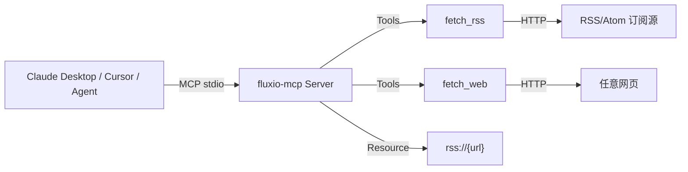

# Fluxio MCP

[](LICENSE)

[](https://github.com/IYABAO/fluxio-mcp/actions/workflows/ci.yml)

信息获取 MCP Server：解析 **RSS/Atom 订阅源**、抓取并提取**网页正文**，让 Claude / Cursor / 各类 Agent 直接读取任意信息源，无需自建爬虫。

> 基于 [FastMCP](https://github.com/jlowin/fastmcp) 实现，纯 Python、零后端依赖，即装即用。

## 架构



- `fetch_rss(url, limit)`：解析 RSS 2.0 / Atom，返回文章列表（标题/链接/时间/摘要）
- `fetch_web(url, max_chars)`：抓取网页并提取正文纯文本，自动去除导航/脚本/样式噪音
- `rss://{url}`：订阅源资源，`rss://<地址>` 返回最近 15 篇

## 快速开始

```bash
# 1. 安装
pip install -e .

# 2. 以 stdio 模式启动（MCP 客户端默认方式）
fluxio-mcp
# 或
python -m fluxio_mcp
```

### 接入 Claude Desktop

编辑 `claude_desktop_config.json`：

```json
{
  "mcpServers": {
    "fluxio": {
      "command": "fluxio-mcp",
      "args": []
    }
  }
}
```

### 接入 Cursor

`Cursor Settings → MCP → Add new MCP Server`：

```
Command: fluxio-mcp
```

### 命令行试运行

```bash
python - <<'PY'
from fluxio_mcp.server import fetch_rss, fetch_web
print(fetch_rss("https://www.ruanyifeng.com/blog/atom.xml", limit=3))
print(fetch_web("https://www.plbear.com/"))
PY
```

## 示例输出

```
> fetch_rss("https://www.plbear.com/index.xml", limit=5)

订阅源：https://www.plbear.com/index.xml
1. 用 Go 重写核心服务……
   链接：https://www.plbear.com/posts/...
   时间：...
   摘要：...
```

## 项目结构

```
src/fluxio_mcp/
├── server.py     # FastMCP Server：工具/资源定义
├── rss.py        # RSS/Atom 解析（标准库 xml.etree，兼容命名空间）
└── web.py        # 网页抓取（httpx）+ 正文提取（BeautifulSoup）
tests/            # pytest 单测（RSS/Atom 解析、噪音清洗、截断、异常）
.github/          # GitHub Actions CI（多 Python 版本自动跑测试）
```

## 测试

```bash
pip install -e .[dev]
pytest
```

CI 会在每次 push/PR 时对 Python 3.10/3.11/3.12 自动运行全部测试。

## Roadmap

- [ ] `search_web`：网页搜索工具（对接搜索引擎 API）
- [ ] 多 URL 批量抓取
- [ ] 网页转 Markdown（保留标题层级/列表/代码块）
- [ ] 发布到 PyPI

## License

MIT
